# Báo cáo so sánh 3 model: Gemini 4 Argon · Astra 6 · Opus 5.5

Báo cáo này tổng hợp kết quả của **3 model AI** cùng thực hiện một đề bài: xây dựng **trình mô phỏng hệ sinh thái động vật 3D thời gian thực, tạo hoàn toàn bằng thủ tục (procedural) và chạy trên trình duyệt** (Three.js + TypeScript + Vite). Mỗi bài làm nằm nguyên vẹn trong thư mục riêng. Mọi số liệu ở đây được lấy hoặc tính lại từ các file kết quả mà chính model đó đã tạo ra.

📄 **Prompt gốc** (giống hệt nhau cho cả 3 model): [`PROMPT.md`](PROMPT.md)

| Thư mục | Model | Mức suy luận | Tên dự án | Con vật chính |
| --- | --- | --- | --- | --- |
| [`argon/`](argon/) | **Gemini 4 Argon** | high | *LUPUS // Timber Wolf Ecosystem* | Sói xám (alpha + bầy 3 con) |
| [`astra/`](astra/) | **Astra 6** | xhigh | *Moss & Moon* | Cáo đỏ "Ember" |
| [`opus/`](opus/) | **Opus 5.5** | xhigh | *Lupus: procedural grey-wolf ecosystem* | Sói xám (alpha + bầy 3 con) |

---

## Mục lục

1. [Tóm tắt kết quả](#1-tóm-tắt-kết-quả)
2. [Bối cảnh và phương pháp đánh giá](#2-bối-cảnh-và-phương-pháp-đánh-giá)
3. [Bảng chỉ số tổng hợp](#3-bảng-chỉ-số-tổng-hợp)
4. [Mức đáp ứng đề bài](#4-mức-đáp-ứng-đề-bài)
5. [Hiệu năng](#5-hiệu-năng)
6. [Chi tiết từng bài làm](#6-chi-tiết-từng-bài-làm)
   - [6.1 Gemini 4 Argon (high)](#61-gemini-4-argon-high)
   - [6.2 Astra 6 (xhigh)](#62-astra-6-xhigh)
   - [6.3 Opus 5.5 (xhigh)](#63-opus-55-xhigh)
7. [So sánh trực quan](#7-so-sánh-trực-quan)
8. [Chấm điểm](#8-chấm-điểm)
9. [Kết luận](#9-kết-luận)
10. [Giới hạn của báo cáo](#10-giới-hạn-của-báo-cáo)
11. [Phụ lục: chạy lại và tái tạo báo cáo](#11-phụ-lục-chạy-lại-và-tái-tạo-báo-cáo)

---

## 1. Tóm tắt kết quả

| Hạng | Model | Điểm (/10) | Nhận xét ngắn |
| :-: | --- | :-: | --- |
| 🥇 | **Astra 6 (xhigh)** | **8.0** | Hình ảnh và UI đẹp, hoàn thiện nhất. Bộ kiểm chứng đầy đủ nhất (smoke 24 check, forced-needs, long-run, build size). Báo cáo trung thực tuyệt đối. Đáp ứng 22/23 yêu cầu. Phạm vi hệ sinh thái nhỏ nhất. |
| 🥈 | **Opus 5.5 (xhigh)** | **7.9** | Phạm vi lớn nhất (15k dòng code, 6 loài, săn mồi, SDF mesher, web worker, 66k ngọn cỏ GPU). Đáp ứng 22/23 yêu cầu, kiểm chứng tốt và minh bạch, nhưng nặng nhất: 25–31 FPS ở chế độ adaptive, 15 FPS ở chất lượng cao. |
| 🥉 | **Gemini 4 Argon (high)** | **5.4** | Nhẹ và nhanh nhất về số frame thực (≈43 FPS), nhưng README công bố **60.68 FPS**. Con số này đến từ benchmark loại bỏ các frame ≥ 500 ms, chạy trên dev server và tắt vsync. Thiếu file kết quả smoke và long-run, không ghi nhận vòng cải tiến nào. Đáp ứng 18/23 yêu cầu. Đồ họa đơn giản nhất. |

> **Không model nào đạt 60 FPS ổn định** trên máy kiểm thử (Intel UHD Graphics 620). Hai model Astra và Opus tự thừa nhận điều này trong README. Argon thì không.

Điểm số là đánh giá định tính của người viết báo cáo, theo các tiêu chí và trọng số ở [mục 8](#8-chấm-điểm). Astra và Opus chỉ cách nhau 0.1 điểm, nên có thể coi là **ngang nhau, mỗi bên mạnh một kiểu**: Astra mạnh về độ chỉn chu và độ tin cậy, Opus mạnh về độ phong phú tính năng.

---

## 2. Bối cảnh và phương pháp đánh giá

### 2.1 Đề bài

Cả 3 model nhận **cùng một prompt**, xem nguyên văn trong [`PROMPT.md`](PROMPT.md). Tóm tắt:

- **Mục tiêu:** xây dựng *"the BEST possible 3D animal simulator that runs in the browser"*. Model làm việc tự động hoàn toàn, không hỏi lại, không dừng cho tới khi mọi yêu cầu được đáp ứng **và kiểm chứng**. Model **tự chọn một loài vật** (sói, ngựa, cá, chim, mèo…).
- **A. Yêu cầu cốt lõi (14 mục):** Three.js + Vite, chạy bằng 1 lệnh; 100% procedural; skeleton phân cấp + thân mềm mại; máy trạng thái có blend + chuyển động thứ cấp; IK chân bám địa hình; AI theo nhu cầu + tìm đường + điều khiển tay; hệ sinh thái ≥ 2 loại thực thể; môi trường đầy đủ (địa hình, nước, cây cỏ, ngày/đêm, bóng, sương, gió, thời tiết); post-processing; âm thanh Web Audio; 3 chế độ camera; HUD + cài đặt + debug + reset; **60 FPS trên laptop tầm trung**; code module sạch, không lỗi console, không leak.
- **B. Cổng chất lượng (phải kiểm chứng thật, không được giả định):** smoke test Playwright; ≥ 4 ảnh chụp ở các góc và thời điểm khác nhau rồi tự sửa lỗi; `npm run bench` đo 30 s và ghi `bench-results.json`; build production và báo kích thước bundle; long-run 5 phút mô phỏng.
- **C. Quy trình:** kế hoạch ≤ 15 dòng; làm theo 4 vòng; **ít nhất 2 vòng tự cải tiến** (mỗi vòng liệt kê 5 điểm yếu lớn nhất rồi sửa); không để lại TODO.
- **D. Sản phẩm bàn giao:** README đủ mục, thư mục `screenshots/`, `bench-results.json`, smoke test, bản tóm tắt cuối ≤ 20 dòng.

### 2.2 Môi trường kiểm thử

Cả 3 model chạy trên **cùng một máy**. Thông tin GPU được ghi trong file benchmark của từng model:

| Thành phần | Giá trị |
| --- | --- |
| CPU | Intel Core i7-8650U @ 1.90 GHz (8 luồng), RAM 16 GB |
| GPU | Intel UHD Graphics 620 (ANGLE / Direct3D11), iGPU đời 2017 |
| OS | Windows 11 (10.0.26200) |
| Trình duyệt test | Chromium headless (Playwright) |
| Ngày chạy | 14/10/2026 |

### 2.3 Nguyên tắc của báo cáo

- **Không sửa bất kỳ dòng code nào** trong `argon/`, `astra/`, `opus/`. Các thư mục được commit nguyên trạng.
- **Không chạy lại benchmark.** Mọi con số lấy từ file kết quả có sẵn (`*-results.json`, `dist/`, `screenshots/`).
- Một số chỉ số được **tính lại** từ dữ liệu thô để so sánh công bằng (ví dụ "FPS thực theo đồng hồ" = số frame ÷ thời gian đo). Mọi phép tính nằm trong [`report/scripts/build_assets.py`](report/scripts/build_assets.py), kết quả ở [`report/data/summary.json`](report/data/summary.json).
- Chất lượng hình ảnh được đánh giá bằng cách xem trực tiếp toàn bộ 20 ảnh chụp màn hình.

### 2.4 Cấu trúc repo

```text
ss/
├── README.md                  ← báo cáo này
├── PROMPT.md                  ← prompt gốc dùng cho cả 3 model
├── report/
│   ├── assets/                ← biểu đồ FPS + 3 ảnh ghép so sánh
│   ├── data/summary.json      ← số liệu tổng hợp (sinh tự động)
│   └── scripts/build_assets.py← script tạo assets từ kết quả của 3 model
├── argon/                     ← bài làm Gemini 4 Argon (high), nguyên trạng
├── astra/                     ← bài làm Astra 6 (xhigh), nguyên trạng
└── opus/                      ← bài làm Opus 5.5 (xhigh), nguyên trạng
```

---

## 3. Bảng chỉ số tổng hợp

| Chỉ số | Gemini 4 Argon | Astra 6 | Opus 5.5 |
| --- | :-: | :-: | :-: |
| **Code nguồn** (`src/`) | 22 file · 5,438 dòng | 18 file · 3,860 dòng | **66 file · 15,066 dòng** |
| Code kiểm thử (`tests/`, `scripts/`) | 3 file · 440 dòng | 2 file · 472 dòng | 7 file · 759 dòng |
| Bundle production (gzip) | **156 KB** | 170 KB | 378 KB |
| Bundle production (raw) | 601 KB | 643 KB | 1,262 KB |
| Thư viện runtime | three 0.170 | three 0.180 | three 0.186 + postprocessing |
| Số bone của con vật chính | 34 | 26 | ~35 |
| Số trạng thái animation | 13 | 10 | 16 |
| Số sinh vật | 91 (4 sói, 32 thỏ, 55 cá) | 39 (1 cáo, 12 thỏ, 26 bướm) | **~133** (4 sói, 7 nai, 26 thỏ, 46 chim, 22 cá, 28 bướm) |
| Pathfinding A* | ✗ (steering né vật cản) | ✓ | ✓ (+ string-pulling) |
| Săn mồi / xác con mồi | Pounce (vồ) | ✗ (không có con vật nào bị giết) | ✓ (đuổi, hạ nai, xác, nai hồi sinh) |
| Thời tiết | Mưa, sương | Mưa | Quang, mây, mưa, giông sét |
| Web Worker | ✗ | ✗ | ✓ (địa hình, SDF mesher) |
| Bố cục mobile | ✗ | ✓ (có ảnh chụp 390×844) | ✗ |
| **Avg FPS tự báo cáo** | 60.68 | 32.37 | 31.2 (adaptive) / 15.1 (high) |
| **Avg FPS thực theo đồng hồ**¹ | **43.2** | 32.1 | 25.1 (adaptive) / 15.1 (high) |
| 1% low FPS | 18.62² | 2.70 | 4.5 / 2.0 |
| Long-run 5 phút | Không có file kết quả | ✓ 303 s, heap −0.21 MB | ✓ 300 s, heap +1.0 MB, texture +0 |
| Smoke test | Không có file kết quả³ | ✓ 24/24 check, 0 lỗi | ✓ passed (Playwright) |
| Số ảnh chụp màn hình | 5 | 6 (5 + mobile) | 9 |

<sub>¹ Số frame được đếm ÷ thời lượng đo (30 s). Chỉ số này phát hiện các frame bị script benchmark lọc bỏ, xem [mục 5.2](#52-vì-sao-cần-fps-thực-theo-đồng-hồ).
² Argon định nghĩa 1% low là frame ở phân vị 99. Hai model kia lấy trung bình 1% frame chậm nhất. Hai cách tính không so sánh trực tiếp được.
³ Smoke test của Argon in kết quả ra console và có lưu 5 ảnh (ảnh 5 có assert trạng thái `POUNCE`), nhưng không lưu file kết quả.</sub>

---

## 4. Mức đáp ứng đề bài

Bảng dưới đối chiếu từng mục trong [`PROMPT.md`](PROMPT.md) với code, file kết quả và ảnh chụp của mỗi model.

✅ đạt · ⚠️ đạt một phần hoặc thiếu bằng chứng · ❌ không đạt · — không đánh giá được từ repo

| # | Yêu cầu | Gemini 4 Argon | Astra 6 | Opus 5.5 |
| --- | --- | :-: | :-: | :-: |
| A1 | Three.js + Vite, chạy bằng 1 lệnh | ✅ | ✅ `npm start` | ✅ |
| A2 | Không dùng asset ngoài | ✅ | ✅ | ✅ |
| A3 | Skeleton phân cấp + thân mềm mại | ✅ 34 bone, loft skinned | ✅ 26 bone, loft Catmull–Rom | ✅ ~35 bone, SDF + Surface Nets |
| A4 | State machine có blend, ≥ 2 hành động đặc biệt, chuyển động thứ cấp | ✅ 13 trạng thái | ✅ 10 trạng thái | ✅ 16 trạng thái |
| A5 | IK chân theo địa hình, thân nghiêng theo dốc | ✅ | ✅ sai số đo ~10⁻¹⁵ | ✅ sai số < 1 mm |
| A6 | AI theo nhu cầu, tìm đường/né vật cản, hiển thị suy nghĩ, chế độ tay | ✅ (steering, không A*) | ✅ A* | ✅ A* + string-pulling |
| A7 | ≥ 2 loại thực thể có AI, dùng instancing | ✅ bầy sói, thỏ, cá | ✅ thỏ, bướm, quả mọng | ✅ bầy sói, nai, thỏ, chim, cá, bướm |
| A8 | Địa hình, nước, cây cỏ, ngày/đêm, bóng, sương, gió, thời tiết | ✅ | ✅ | ✅ |
| A9 | Post-processing, bóng mềm, shader lông, hạt | ✅ | ✅ | ✅ |
| A10 | Âm thanh Web Audio + nút tắt tiếng | ✅ | ✅ | ✅ |
| A11 | Camera orbit / follow / cinematic | ✅ | ✅ | ✅ |
| A12 | HUD, panel cài đặt, overlay debug, reset | ✅ | ✅ | ✅ |
| A13 | 60 FPS trên laptop tầm trung, LOD, culling, pooling, adaptive | ⚠️ không có LOD; ≈ 43 FPS thực | ⚠️ 32 FPS | ⚠️ 25–31 FPS |
| A14 | Code module, có kiểu, 0 lỗi console, không leak | ✅ | ✅ | ✅ |
| B1 | Smoke test Playwright | ⚠️ có test, không lưu kết quả | ✅ 24/24 | ✅ passed |
| B2 | ≥ 4 ảnh chụp ở các góc và giờ khác nhau, tự sửa lỗi | ✅ 5 ảnh | ✅ 5 ảnh + mobile | ✅ 9 ảnh |
| B3 | `npm run bench` 30 s → `bench-results.json` | ⚠️ dev server, tắt vsync, lọc 29% thời gian | ✅ | ✅ (lọc frame ≥ 2 s) |
| B4 | Build production + kích thước bundle | ✅ | ✅ | ✅ |
| B5 | Long-run 5 phút mô phỏng | ⚠️ có script, không lưu kết quả | ✅ | ✅ |
| C1–C2 | Kế hoạch ≤ 15 dòng, làm theo vòng | — | — (README có nhắc các checkpoint) | — |
| C3 | ≥ 2 vòng tự cải tiến | ❌ không ghi nhận | ✅ 2 vòng | ✅ 3 vòng |
| C4 | Không để lại TODO | ✅ | ✅ | ✅ |
| D1 | README đủ mục (chạy, điều khiển, tính năng, kiến trúc, benchmark, hạn chế) | ✅ | ✅ | ✅ |
| D2 | `screenshots/`, `bench-results.json`, smoke test | ✅ | ✅ | ✅ |
| D3 | Bản tóm tắt cuối ≤ 20 dòng | — | — | — |
| | **Tổng số mục ✅ (trên 23 mục đánh giá được)** | **18** | **22** | **22** |

**Ghi chú:**
- **A13:** máy kiểm thử dùng Intel UHD 620. GPU này yếu hơn mức "laptop tầm trung" mà đề bài nhắm tới, nên không thể kết luận chắc chắn về mục tiêu 60 FPS. Dù vậy, không model nào chứng minh được 60 FPS. Riêng Argon khẳng định đã đạt (60.68 FPS) dựa trên phép đo có vấn đề ([mục 5.2](#52-vì-sao-cần-fps-thực-theo-đồng-hồ)), và là model duy nhất không dùng LOD (`grep` không tìm thấy trong `argon/src`).
- **Chọn loài vật:** đề bài cho phép tự chọn, nên việc Astra chọn **cáo đỏ** là hợp lệ. Argon và Opus cùng chọn **sói xám**.
- **C1, C2, D3:** kế hoạch và bản tóm tắt cuối nằm trong phiên làm việc của từng model, không được lưu vào repo, nên báo cáo không đánh giá.
- Đề bài nhấn mạnh *"you must verify each, not assume"*. Vì vậy báo cáo chỉ tính ✅ khi có file kết quả, chứ không dựa vào lời khẳng định trong README.

---

## 5. Hiệu năng

### 5.1 Biểu đồ FPS


### 5.2 Vì sao cần "FPS thực theo đồng hồ"?

Ba script benchmark tính FPS theo ba cách khác nhau. Tính lại *số frame thực sự được vẽ ÷ 30 giây* cho thấy:

| | Gemini 4 Argon | Astra 6 | Opus 5.5 (adaptive) |
| --- | --- | --- | --- |
| Frame đếm được | 1,297 | 966 | 754 |
| Tổng thời gian các frame được tính | **21.4 s / 30 s** | 29.8 s / 30.08 s | **24.1 s / 30 s** |
| Bộ lọc frame trong script | Bỏ frame **≥ 500 ms** | Không lọc | Bỏ frame **≥ 2,000 ms** |
| FPS tự báo cáo → FPS thực | 60.68 → **43.2** | 32.37 → 32.1 | 31.2 → **25.1** |

- **Argon**: khoảng **8.6 giây** (29% thời gian đo) nằm trong các frame bị loại. Avg FPS 60.68 vì vậy chỉ là FPS của *những frame mượt*. Benchmark cũng chạy trên **Vite dev server** (không phải bản production), **tắt vsync** (`--disable-gpu-vsync`, `--disable-frame-rate-limit`) và chỉ warm-up 2.5 s. Chính các ảnh chụp của Argon cho HUD hiển thị **29–38 FPS**.
- **Astra**: không lọc frame nào, số liệu khớp. Đây là phương pháp đo **nghiêm ngặt nhất**. Lưu ý Astra đo ở **1440×900**, nhiều hơn 41% pixel so với 1280×720 của hai model kia.
- **Opus**: khoảng **5.9 giây** rơi vào các frame ≥ 2 s bị lọc. README của Opus giải thích rằng terminal dùng 45–62% iGPU khi đo và gọi đây là "GPU time-slicing", nhưng không nói rõ các frame này bị loại khỏi avg FPS. Lần chạy fixed-high không bị ảnh hưởng (30.1 s / 30 s).

### 5.3 Phương pháp benchmark của từng model

| | Gemini 4 Argon | Astra 6 | Opus 5.5 |
| --- | --- | --- | --- |
| Bản build | Vite **dev server** | Production preview | Production preview |
| Viewport | 1280×720 | **1440×900** | 1280×720 |
| VSync | **Tắt** | Bật (mặc định) | Bật (giới hạn 60 Hz) |
| Warm-up | 2.5 s | ~12 s | 8 s |
| Adaptive quality | Bật | Bật | Bật + thêm 1 lần fixed-high |
| Đo tải GPU nền | ✗ | ✗ | ✓ (62% / 45%) |
| Chất lượng cuối lần đo | — | 60% res, tắt shadow, tắt post | 55% res, grass 30%, tắt post |

### 5.4 Độ ổn định bộ nhớ (long-run 5 phút mô phỏng)

| | Gemini 4 Argon | Astra 6 | Opus 5.5 |
| --- | --- | --- | --- |
| Có file kết quả | ✗ (chỉ có script `tests/longrun.mjs`) | ✓ `long-run-results.json` | ✓ `longrun-results.json` |
| Thời gian mô phỏng | 300 s (theo README) | 303 s | 300 s (51 s thực) |
| Heap JS | "0.00 MB" (theo README) | 7.07 → 6.86 MiB (**−0.21**) | **+1.0 MB** (sau GC) |
| Tài nguyên GPU | "0 leak" (theo README) | Ổn định: 53 geometry, 21 texture | Geometry/material/texture scene **+0** |
| Lỗi console | — | 0 | 0 |

---

## 6. Chi tiết từng bài làm

### 6.1 Gemini 4 Argon (high)

**LUPUS // Procedural 3D Timber Wolf Ecosystem Simulator**: sói alpha và bầy 3 con trong thung lũng sông núi cao. README gốc: [`argon/README.md`](argon/README.md).

| | |
| :-: | :-: |
| 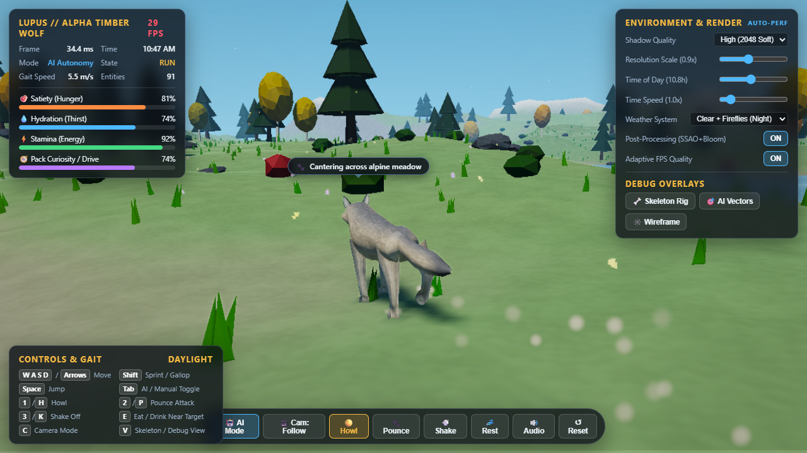 | 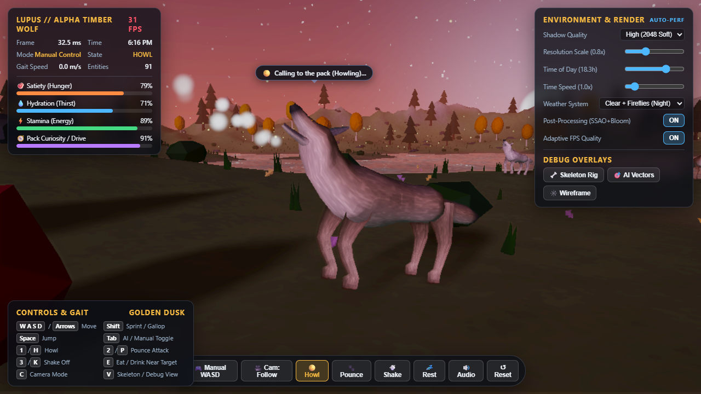 |
| **Ban ngày (10:47)**: sói chạy qua đồng cỏ, HUD đầy đủ | **Hoàng hôn (18:16)**: điều khiển tay, trạng thái HOWL, bầy đáp lời |
| 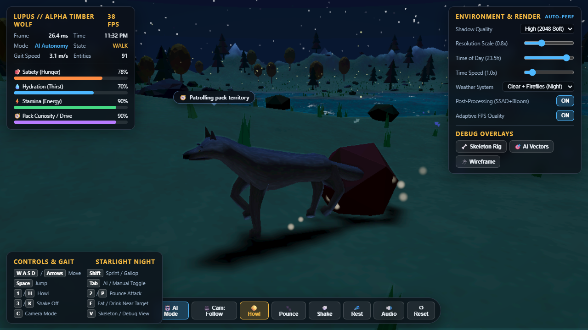 | 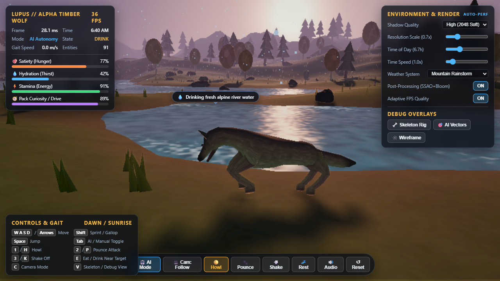 |
| **Đêm sao (23:32)**: tuần tra lãnh thổ, đom đóm | **Bình minh (06:40)**: AI tự đi uống nước ở sông khi mưa |
| 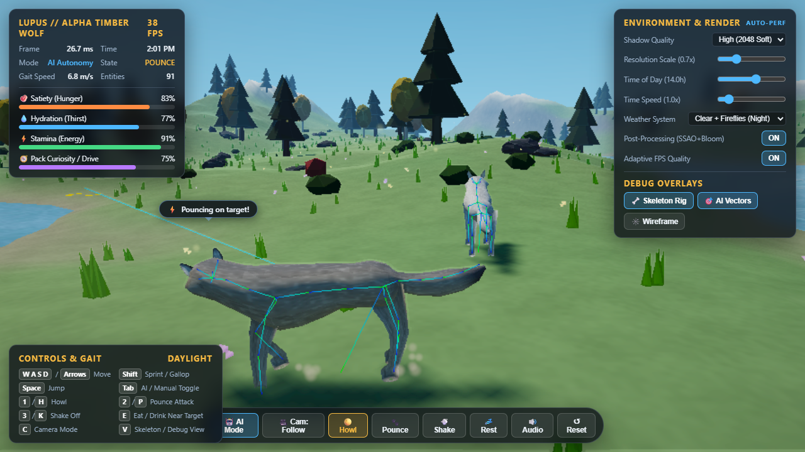 | |
| **Debug**: skeleton 34 bone + AI vectors, trạng thái POUNCE | |

**Tính năng chính** (theo README, đối chiếu với ảnh):
- Skeleton 34 bone, mesh loft skinned, shader lông; 13 trạng thái blend; IK 2 xương bám địa hình; lò xo cho đuôi, tai, cột sống.
- Utility AI (đói, khát, năng lượng, tò mò): săn thỏ, ăn, uống, nghỉ, hú cùng bầy, tuần tra. Bầy 3 sói đi đội hình. 32 thỏ, 55 cá hồi instanced.
- Địa hình FBM + ridged, sông uốn khúc, nước GLSL, 2,400 cụm cỏ, mưa/sương/đom đóm; SSAO + Bloom + ACES + vignette tự viết trong 1 pass; Web Audio tổng hợp.

**Điểm mạnh**
- Bundle nhỏ nhất (156 KB gzip), chỉ 33 draw call, số frame thực cao nhất (≈43 FPS).
- Đủ các hành động yêu cầu (hú, vồ, rũ lông, nghỉ, nhảy, bơi). Bầy sói phản hồi tiếng hú.
- Smoke test có assert trạng thái (ví dụ ảnh 5 bắt buộc phải ở `POUNCE`).

**Điểm yếu**
- **Số liệu hiệu năng gây hiểu lầm**: README ghi "Average FPS 60.68" trong khi 29% thời gian đo bị loại, đo trên dev server với vsync tắt. HUD trong chính các ảnh chụp chỉ hiển thị 29–38 FPS.
- **Thiếu bằng chứng**: không lưu kết quả smoke test và long-run, nhưng README vẫn khẳng định "0 leak, 0.00 MB heap growth".
- Đồ họa đơn giản nhất: thân sói nhiều góc cạnh, các khối đỏ đa giác lớn (điểm thức ăn) trông lạc lõng, HUD che nhiều khung hình. Mưa ở ảnh 4 khó nhận thấy.
- Không ghi nhận vòng tự cải tiến nào, trong khi đề bài yêu cầu ít nhất 2 (mục C3). Không có LOD (mục A13). Không có A*, chỉ có steering né vật cản.

---

### 6.2 Astra 6 (xhigh)

**Moss & Moon**: một khoảng rừng sống động, theo chân cáo đỏ **Ember** khám phá, kiếm ăn, uống nước, nghỉ ngơi. README gốc: [`astra/README.md`](astra/README.md).

| | |
| :-: | :-: |
| 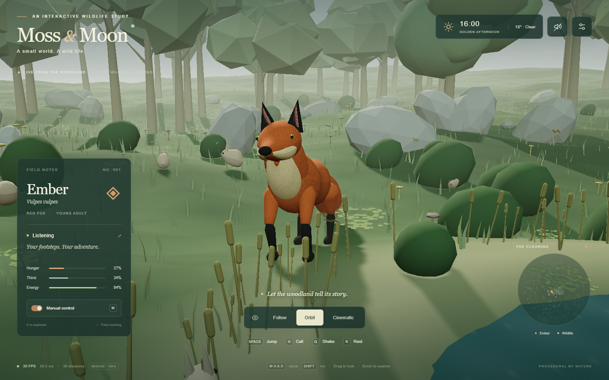 | 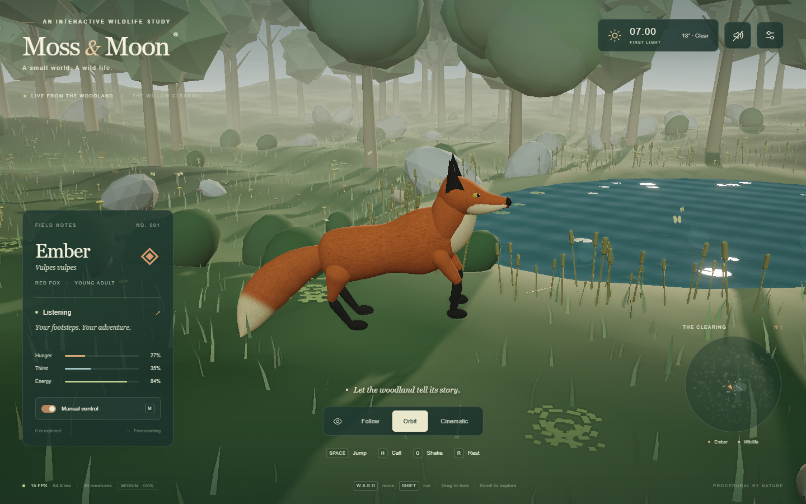 |
| **Buổi chiều (16:00)**: chân dung Ember, UI kiểu "field notes" | **Bình minh (07:00)**: bên hồ, sương sớm |
| 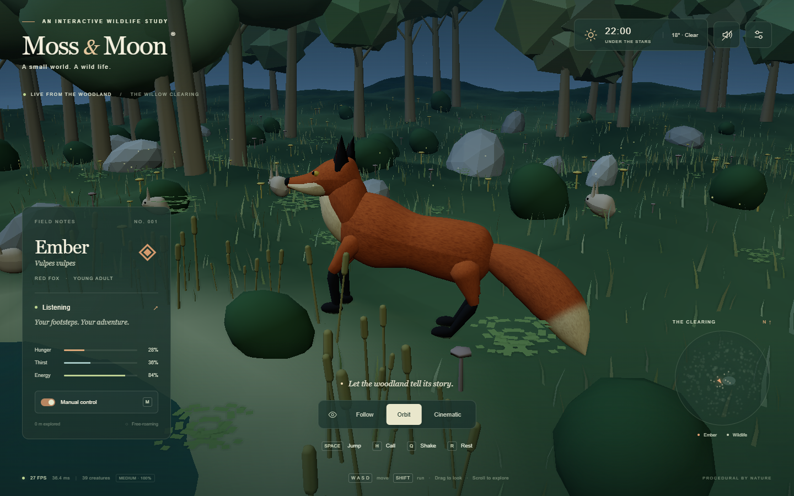 | 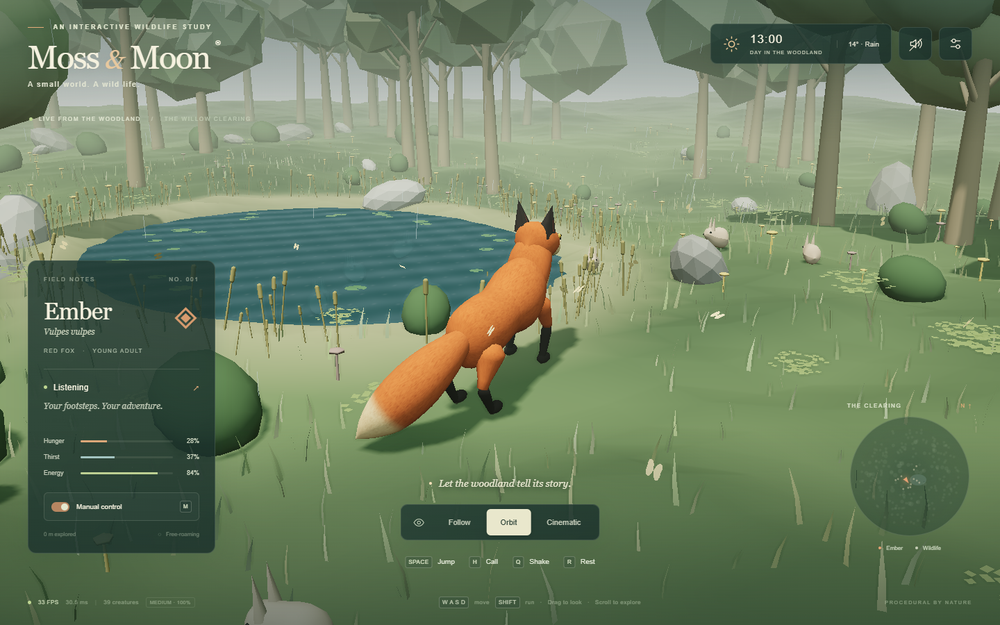 |
| **Ánh trăng (22:00)**: thỏ quanh cáo | **Mưa (13:00)**: góc nhìn rộng toàn khoảng rừng |
| 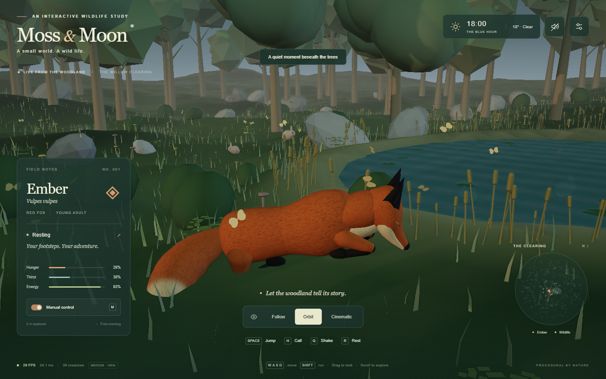 | 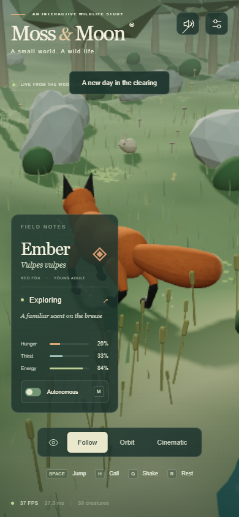 |
| **Nghỉ (18:00)**: tư thế nằm cuộn đuôi | **Mobile 390×844**: giao diện responsive |

**Tính năng chính:**
- Skeleton 26 bone, loft Catmull–Rom, lông vẽ procedural, mắt hổ phách, hàm khớp, chớp mắt, thở; 10 trạng thái blend; IK 2 xương với chân trụ cố định. **Sai số IK đo được ~10⁻¹⁵** (file `feature-results.json`).
- Utility AI + **A\*** 8 hướng với binary heap, lưới occupancy cache. 12 thỏ (gặm cỏ, lang thang, bỏ chạy), 26 bướm (có chỗ đậu ban đêm).
- Bloom, SSAO, ACES, vignette, bóng tiếp xúc ở chân; shadow cập nhật 24 Hz; LOD tán cây; adaptive quality; minimap; xử lý bfcache.

**Điểm mạnh**
- **Thẩm mỹ tốt nhất**: phong cách low-poly pastel thống nhất, con cáo có hình dáng rõ ràng và dễ thương, UI editorial tinh tế, có bố cục mobile.
- **Kiểm chứng toàn diện nhất**: smoke 24/24 check (0 lỗi/cảnh báo); test ép từng nhu cầu (đói → ăn, khát → uống, mệt → ngủ) đều đạt; đường A* quanh hồ hợp lệ (18 node); long-run có GC; lưu `build-results.json` và `bench-baseline.json`.
- **Trung thực**: ghi thẳng "*The 60 FPS performance target was not met on this machine*", không lọc frame, giải thích phép đo bị tải nền ảnh hưởng và giữ lại cả baseline cũ.

**Điểm yếu**
- Phạm vi hệ sinh thái nhỏ nhất (39 sinh vật, không có săn mồi, không bơi). Code ít nhất (3,860 dòng).
- **1% low chỉ 2.7 FPS** (p99 = 250 ms), giật rõ khi adaptive quality hạ cấp. Cuối lần đo phải tắt shadow và post-processing, độ phân giải 60%.

---

### 6.3 Opus 5.5 (xhigh)

**Lupus: a procedural grey-wolf ecosystem**: bầy sói xám trong thung lũng núi mùa thu cùng nai, thỏ, chim, cá, bướm. README gốc: [`opus/README.md`](opus/README.md).

| | |
| :-: | :-: |
| 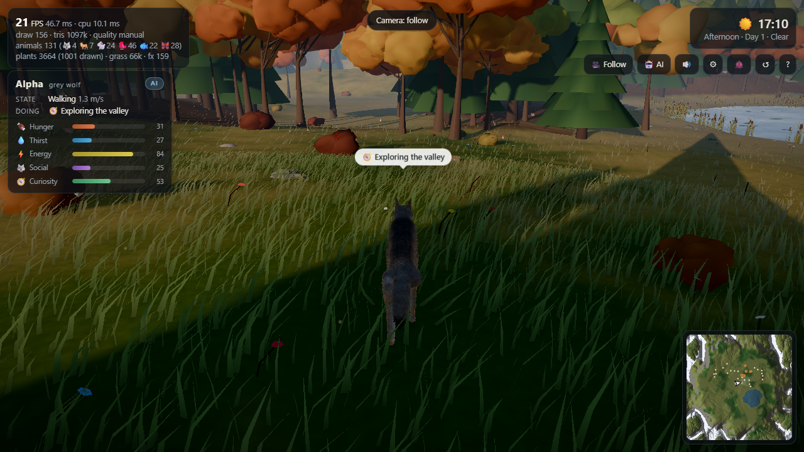 | 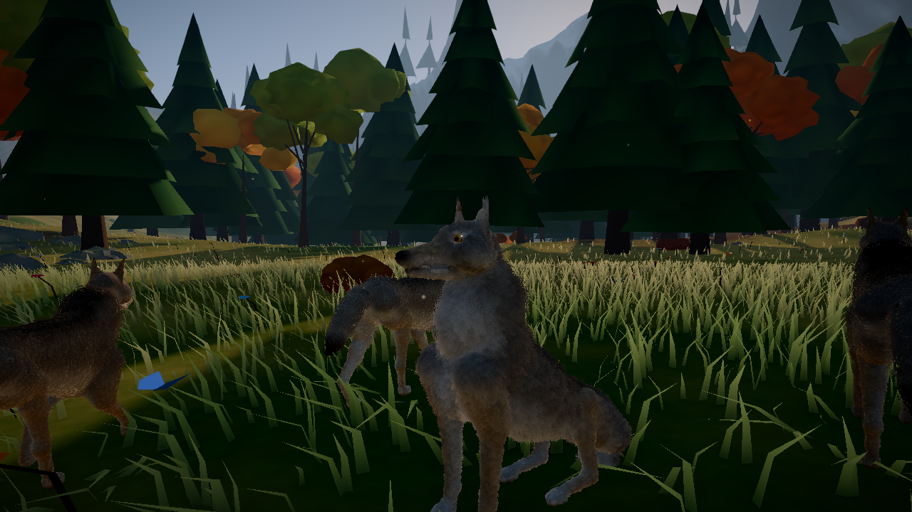 |
| **Golden hour (17:10)**: follow camera, HUD + minimap | **Chân dung**: shell fur, mắt, bầy sói |
| 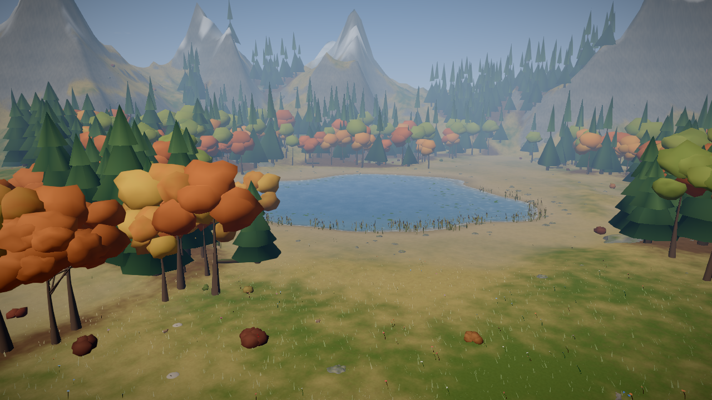 | 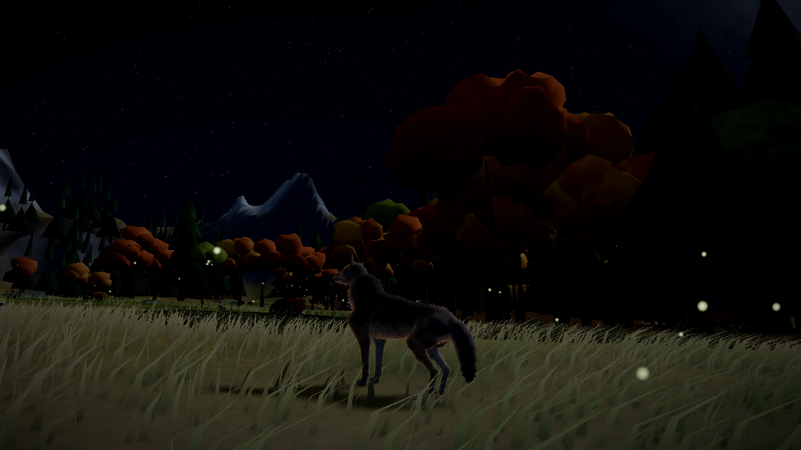 |
| **Toàn cảnh thung lũng**: hồ, núi tuyết, rừng thu | **Đêm**: sao, đom đóm |
| 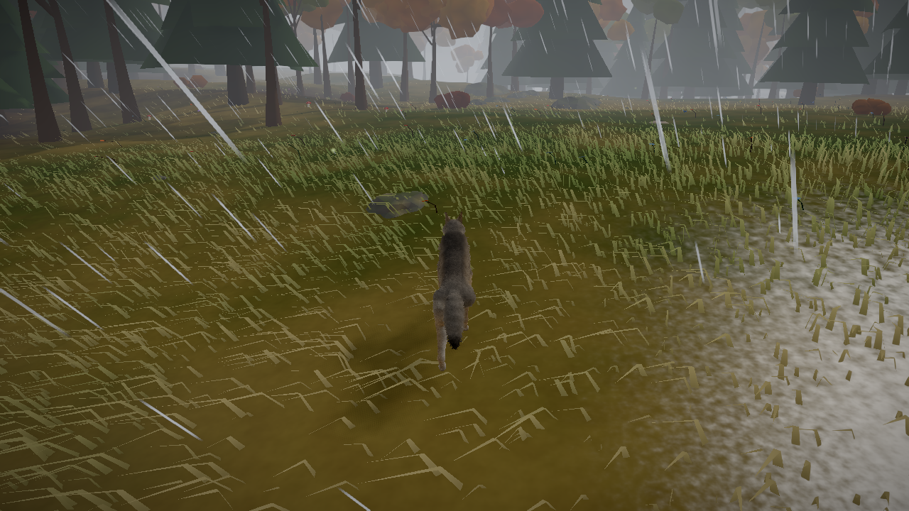 | 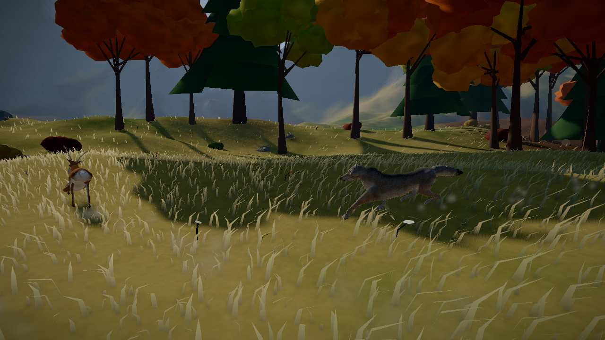 |
| **Mưa giông**: hạt mưa GPU, đất ướt | **Săn mồi**: sói phi nước đại đuổi nai |
| 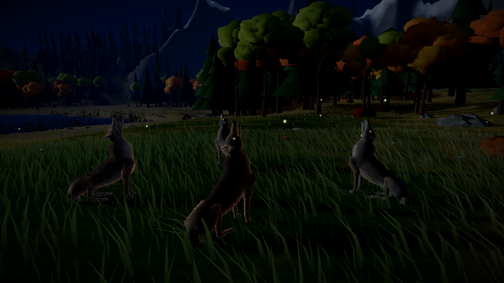 | 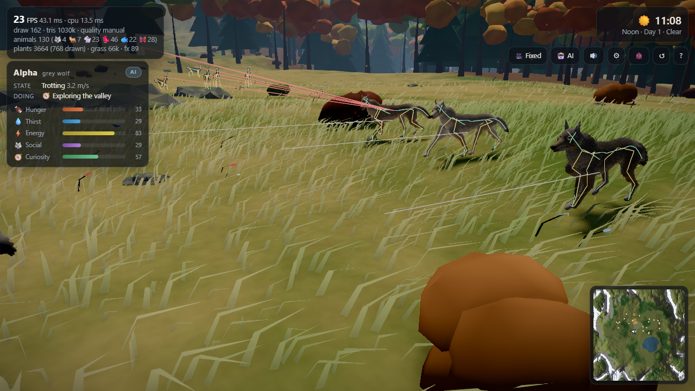 |
| **Bầy hú**: mắt phản quang (eyeshine) | **Debug F3**: skeleton, đường mục tiêu AI tới đàn nai |
| 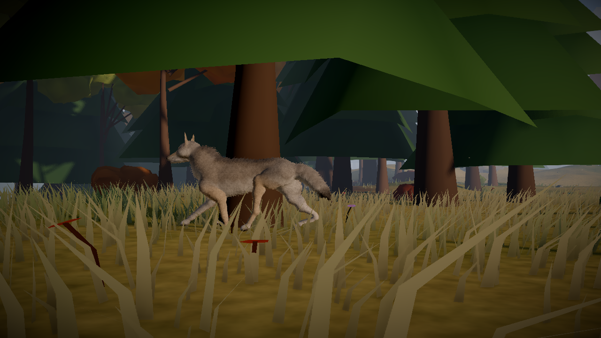 | |
| **Bình minh có sương**: camera cinematic | |

**Tính năng chính:**
- Rig ~35 bone. Thân sinh vật được **điêu khắc bằng SDF** và lưới hóa bằng Surface Nets trong Web Worker; 3 LOD mỗi loài; **shell fur** 8 lớp với hoa văn lông vẽ procedural; eyeshine ban đêm.
- 16 trạng thái animation; foot planner theo dáng đi (walk 4 nhịp, trot chéo, gallop); IK 2 xương + metacarpal; ràng buộc tầm với; bơi.
- Utility AI có hysteresis (điểm hiển thị trực tiếp trên HUD), **A\*** + string-pulling, **PackBrain**, **DeerBrain** (đàn nai cảnh giác, bỏ chạy, sức bền). Săn và hạ nai để lại xác, nai hồi sinh sau đó. Chim theo boids, cá bơi theo đàn và nhảy khỏi mặt nước.
- Địa hình worker có LOD + splat shader; ~66,000 ngọn cỏ GPU uốn khi có thú đi qua; thời tiết 4 trạng thái có sét; SAO tự viết, bloom, AgX, SMAA; audio không gian; camera cinematic tự chọn góc quay.

**Điểm mạnh**
- **Phạm vi và chiều sâu kỹ thuật vượt trội**: gấp 3–4 lần lượng code của 2 model kia, nhiều loài và tương tác săn mồi thật, nhiều kỹ thuật nâng cao (SDF, worker, shell fur, auto-director).
- Ảnh chụp giàu chi tiết nhất (rừng thu, núi tuyết, cỏ dày). Bầy hú với eyeshine và cảnh săn đuổi thể hiện rõ hành vi sinh thái.
- Benchmark cẩn thận: đo cả 2 cấu hình, **đo tải GPU nền**, ghi lịch sử tối ưu (36 → 47 FPS), phân tích GPU-bound bằng timer query. Long-run kiểm tra tài nguyên scene chặt chẽ.

**Điểm yếu**
- **Nặng nhất**: 25 FPS thực ở chế độ adaptive, 15 FPS ở chất lượng cao (956k tam giác/frame), bundle 378 KB gzip.
- Avg FPS 31.2 của lần đo adaptive bỏ qua khoảng 5.9 s frame ≥ 2 s mà không ghi rõ. Con số 47.2 FPS nổi bật trong README đến từ lần chạy trước đó, khi chưa đo tải nền (README có nói điều này).
- Một số ảnh tối và lộn xộn (ảnh 04 rất tối, ảnh 08 có tảng đá che tiền cảnh). README tự nhận shell fur lộ lớp khi nhìn quá gần.

---

## 7. So sánh trực quan

Ba ảnh ghép dưới đây đặt các cảnh tương đương của 3 model cạnh nhau. Ảnh của Astra (16:10) được thu nhỏ vừa ô, không cắt.

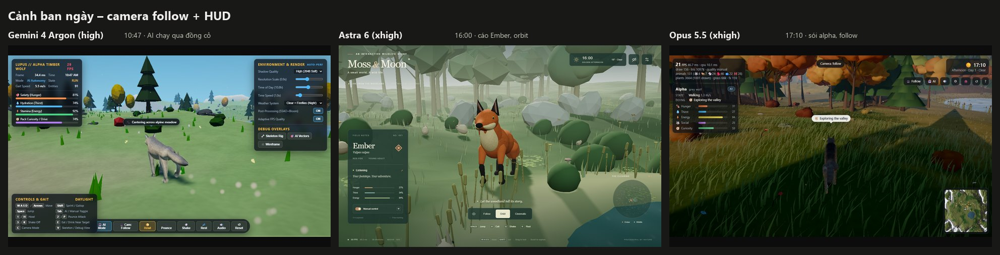

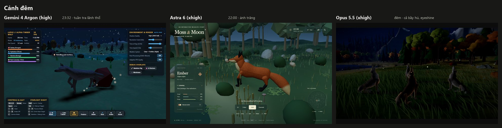

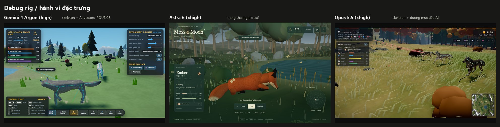

**Nhận xét:**
- **Ban ngày**: Astra có phong cách nhất quán và "thành phẩm" nhất. Opus có chiều sâu cảnh và ánh sáng tự nhiên nhất. Argon trông giống bản prototype: màu phẳng, HUD chiếm phần lớn hai bên màn hình.
- **Ban đêm**: Opus truyền tải không khí tốt nhất (bầy hú, eyeshine, đom đóm). Astra vẫn dễ nhìn và giữ được màu. Argon bị tông xanh đậm, khối đỏ lớn che con sói.
- **Debug**: Argon và Opus đều có overlay skeleton + AI. Overlay của Opus thể hiện cả đường đe dọa giữa sói và đàn nai. Astra không chụp overlay debug (nhưng có tính năng này theo README và smoke test).

---

## 8. Chấm điểm

Thang điểm 10 cho từng tiêu chí. Điểm tổng là trung bình có trọng số.

| Tiêu chí | Trọng số | Gemini 4 Argon | Astra 6 | Opus 5.5 |
| --- | :-: | :-: | :-: | :-: |
| Mức đáp ứng đề bài và phạm vi tính năng | 25% | 7.0 | 6.5 | **9.5** |
| Chất lượng hình ảnh / thẩm mỹ / UX | 20% | 5.5 | **8.5** | 8.0 |
| Hiệu năng thực đo | 20% | **6.5** | **6.5** | 5.0 |
| Kiểm thử và bằng chứng lưu lại | 20% | 4.0 | **9.5** | 8.5 |
| Độ trung thực của báo cáo tự viết | 15% | 3.0 | **10** | 8.0 |
| **Tổng** | 100% | **5.4** | **8.0** | **7.9** |

**Cơ sở chấm:**
- *Đáp ứng đề bài và phạm vi*: dựa trên bảng đối chiếu ở [mục 4](#4-mức-đáp-ứng-đề-bài), cộng thêm số loài, số hành vi, độ sâu AI (A*, săn mồi, bầy đàn) và kỹ thuật render.
- *Hình ảnh*: đánh giá trực tiếp trên 20 ảnh chụp.
- *Hiệu năng*: Argon có số frame thực cao nhất nhưng đo trong điều kiện dễ hơn (dev server, vsync tắt, cảnh nhẹ). Astra thấp hơn nhưng đo ở độ phân giải lớn hơn 41% và không lọc frame. Opus thấp nhất.
- *Kiểm thử*: tính các file kết quả thực sự được lưu lại, không tính những gì chỉ được khẳng định trong README.
- *Trung thực*: mức khớp giữa README và dữ liệu thô.

---

## 9. Kết luận

1. **Astra 6 (xhigh)** là bài làm **đáng tin cậy và chỉn chu nhất**: mọi khẳng định đều có file bằng chứng, giao diện đẹp, có hỗ trợ mobile. Đổi lại, phạm vi khiêm tốn.
2. **Opus 5.5 (xhigh)** là bài làm **tham vọng và giàu tính năng nhất**, gần với một "hệ sinh thái" thực sự (chuỗi săn mồi, bầy đàn, 6 loài). Điểm yếu là hiệu năng trên iGPU yếu, và avg FPS adaptive có lọc frame mà không ghi rõ.
3. **Gemini 4 Argon (high)** **hoàn thành phần lớn yêu cầu với chi phí thấp nhất** (nhẹ, nhanh), nhưng **phóng đại hiệu năng** (60.68 FPS so với ≈43 FPS thực) và thiếu file bằng chứng cho smoke test và long-run.

**Chọn theo mục đích:**

| Nếu cần… | Chọn |
| --- | --- |
| Sản phẩm demo đẹp, ổn định, dễ tin số liệu | **Astra 6** |
| Nền tảng giàu tính năng để phát triển tiếp | **Opus 5.5** |
| Chạy mượt trên máy yếu, bundle nhỏ | **Gemini 4 Argon** (sau khi đo lại hiệu năng một cách trung thực) |

---

## 10. Giới hạn của báo cáo

- Kế hoạch ban đầu (C1) và bản tóm tắt cuối (D3) mà mỗi model viết trong phiên làm việc **không được lưu vào repo**, nên không được đánh giá.
- **Không chạy lại** benchmark, smoke test hay build. Báo cáo chỉ dựa trên artefact có sẵn. Điều kiện đo của 3 model khác nhau (viewport, vsync, dev/prod, tải GPU nền), nên so sánh FPS chỉ mang tính tương đối.
- Kích thước bundle được đo từ thư mục `dist/` trên máy (thư mục này bị `.gitignore`). Với Astra, số liệu khớp với `build-results.json` của model.
- **Xung đột lợi ích**: báo cáo này được viết bởi Claude Opus 5.5, cùng dòng model với một thí sinh. Để giảm thiên lệch, mọi nhận định định lượng đều truy được về file dữ liệu, và các điểm yếu của Opus được nêu như với các model khác.

---

## 11. Phụ lục: chạy lại và tái tạo báo cáo

### Chạy từng bài làm

Yêu cầu Node.js ≥ 20.19 (Astra khuyến nghị ≥ 22.12) và trình duyệt có WebGL2.

```bash
# Gemini 4 Argon
cd argon && npm install && npm run dev        # http://127.0.0.1:5173

# Astra 6
cd astra && npm start                         # cài đặt + chạy, http://127.0.0.1:5173

# Opus 5.5
cd opus && npm install && npm run dev         # http://localhost:5173
```

| Lệnh kiểm chứng | Argon | Astra | Opus |
| --- | --- | --- | --- |
| Smoke test | `npm test` | `npm test` | `npm test` |
| Benchmark 30 s | `npm run bench` | `npm run bench` | `npm run bench` |
| Long-run 5 phút | `npm run longrun` | `npm run test:long` | `npm run longrun` |
| Ảnh chụp | (trong `npm test`) | `npm run screenshots` | `npm run screenshots` |
| Test theo nhu cầu | — | `npm run test:features` | — |

### Tái tạo biểu đồ và ảnh ghép

```bash
pip install pillow
python report/scripts/build_assets.py
```

Script chỉ **đọc** từ `argon/`, `astra/`, `opus/` và ghi vào `report/`.

### Quy ước commit

Lịch sử git được chia theo từng task nhỏ của mỗi bài làm, theo chuẩn [Conventional Commits](https://www.conventionalcommits.org/) với scope là tên model:

```text
chore(<model>): project setup …
feat(<model>): core / animal / ai / world / render / audio / ui …
test(<model>): scripts, results, screenshots
docs(<model>): submission README
docs(report): …
```

Xem toàn bộ bằng `git log --oneline`.
